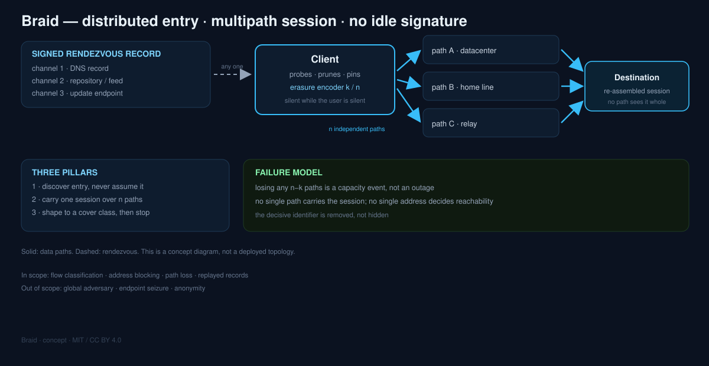

# Braid

**A distributed-entry tunnel concept — no single endpoint, no single flow, no idle signature.**

> Status: **concept**. No implementation yet. This repository exists to be argued with.

---

## 1. The problem with good camouflage

Censorship systems have moved past address blocklists. Modern filters classify *flows*: they read
the first handshake, then the shape of what follows — packet sizes, inter-arrival times, direction
changes, and how long the connection lives.

The current generation of transports answers this well, but every one of them keeps two invariants:

1. **One endpoint per session.** The client resolves or is configured with a single reachable
   address. Block that address and the session is over.
2. **One continuous flow.** The connection is kept warm with heartbeats and self-similar traffic,
   because a tunnel that goes quiet looks broken to middleboxes and NATs.

Camouflage improves *what the flow looks like*. It does not change *how many things must go right*.
That is the gap this concept explores.

## 2. Insight

> Blocking is cheap when a single identifier is decisive.

Make no identifier decisive:

- **Entry is discovered, not known.** The client never depends on one address being reachable.
- **A session is carried over several paths.** No single flow contains the session.
- **The tunnel is silent when the user is silent.** No idle heartbeat to fingerprint.

The property this buys is different in kind from "hard to block". It is **graceful degradation**:
losing one path costs capacity, not connectivity.

## 3. Design — three pillars

### 3.1 Rendezvous without a fixed address

The client needs an initial set of candidates, and later a refreshed set. Instead of a static
configuration, candidates are published as a signed, versioned record over **several independent
channels** (for example: DNS records, a public repository, an update feed). Any one channel is
enough to bootstrap; no single channel is load-bearing.

Properties required of the record:

- signed, so a compromised channel cannot inject endpoints;
- monotonic version, so a replayed old record is detectable;
- decoy-tolerant: bogus entries are permitted, the client probes and prunes.

The filter's cost model changes here: to stop discovery it must block *all* channels
simultaneously, and usually one of them is expensive to block.

### 3.2 Multipath with erasure coding

A session is split across `n` independent paths (different hosts, different networks, ideally
different operators). Payload is encoded with a systematic erasure code at rate `k/n`, so the
session survives the loss of any `n−k` paths without a retransmission storm.

Two consequences, both deliberate:

- **No path sees a complete session.** Classic flow classifiers look for the *whole* pattern;
  a fragment looks like less traffic to more places.
- **Failure is a capacity event, not an outage.** Path loss degrades throughput smoothly.

Path health is monitored by the same data flow, not by dedicated probes — probes are a signature.

### 3.3 Shape, then silence

Traffic is shaped toward a stated cover class (for example, interactive browsing or a video call),
matching size distribution and timing *statistics* rather than a fixed pattern. When the user is
idle, nothing is sent: session state lives at both ends, and re-entry is a fresh, cheap handshake.

This is the least mature pillar and the most likely to be wrong. It is listed as an experiment,
not a claim.

## 4. Threat model

**In scope**

- Flow-classification middleboxes that key on handshake fingerprints and traffic shape.
- Address blocking, including blocking of well-known hosting ranges.
- Loss of individual paths, hosts, or publishing channels.
- Replay of stale rendezvous records.

**Out of scope**

- A global adversary that blocks all channels and all paths simultaneously.
- Endpoint compromise (a seized host is a seized host).
- Anonymity. Braid is a transport; it does not hide *who* is talking, and does not pretend to.
- Active probing that is answered by the server with distinguishing behaviour — a real risk that
  needs a per-deployment answer, not a protocol feature.

## 5. What Braid is not

- **Not new cryptography.** It composes standard primitives (TLS‑class transport, Ed25519
  signatures, an erasure code). Rolling your own crypto is how projects die quietly.
- **Not an anonymity network.** No onion routing, no cover traffic for anonymity's sake.
- **Not a CDN trick.** It can *use* a CDN as one path, but the concept does not depend on any
  single provider's tolerance.
- **Not a product.** There is no client, no server, no protocol specification yet.

## 6. Test plan — three experiments, each with a pass/fail line

The concept is only worth building if these three hold. Each is small enough to run in a day with
off-the-shelf parts.

### E1 — Discovery under blocking

Publish a signed candidate record over three channels; block one channel at a time.
**Pass:** a cold client bootstraps within 30 s with any single channel available.
**Fail:** any single channel is load-bearing.

### E2 — Path failure tolerance

Run a session over three paths with a 2-of-3 code; kill one path mid-transfer.
**Pass:** session survives, throughput drops by roughly the coded rate, no reconnect.
**Fail:** session resets, or recovery takes more than a few seconds.

### E3 — Shape distinguishability

Capture packet size and inter-arrival features for (a) Braid, (b) a reference cover class.
Train a simple classifier.
**Pass:** AUC close to the cover class's own self-classification floor.
**Fail:** Braid is separable — in which case pillar 3.3 is dropped and the concept narrows to
distributed entry + multipath.

## 7. Prior art, and what is actually different

| Work | What it does | What Braid adds |
|---|---|---|
| Tor pluggable transports (obfs4, meek, snowflake) | Camouflage, and in Snowflake's case volunteer proxies | Multipath session coding; signed multi-channel rendezvous |
| REALITY-style TLS impersonation | Makes one flow look like a real site | Removes the single-flow assumption |
| CDN fronting / domain fronting | Borrows a well-connected entry IP | Treats the CDN as one path among several, not the only hope |
| MPTCP | Multipath at the transport layer | Applies it above heterogeneous, independently blockable channels |
| Erasure-coded tunnels (e.g. FEC in VPNs) | Recovers loss on one path | Uses redundancy across *paths*, as a blocking-resistance property |

The novel part is the **composition**, not any single mechanism. Every component exists; nobody
ships them together with "no identifier is decisive" as the design rule.

## 8. Open problems

- **Cost of shaping.** Statistical mimicry needs a model per cover class, and models drift.
- **Path heterogeneity.** Three paths with different latency wreck naive ordering; the scheduler
  is the hard part.
- **Rendezvous freshness vs. replay.** Short-lived records improve security and worsen cold start.
- **Abuse.** A distributed entry point is also a distributed entry point for abuse; policy has to
  be designed, not bolted on.
- **Measurement ethics.** Testing against a live national filter is not a neutral act; do it with
  consent, and publish method, not targets.

## 9. If you want to help

Useful contributions right now are **criticism**, not code:

- a counter-argument to pillar 3.2 (why would multipath not help against a state filter?),
- prior art we missed,
- a cheaper experiment that falsifies the concept faster than E1–E3.

Open an issue with the strongest objection you can make. That is the point of publishing early.

## License

Code: MIT — see [LICENSE](LICENSE). Text and diagrams: CC BY 4.0 — see [LICENSE-docs](LICENSE-docs).
